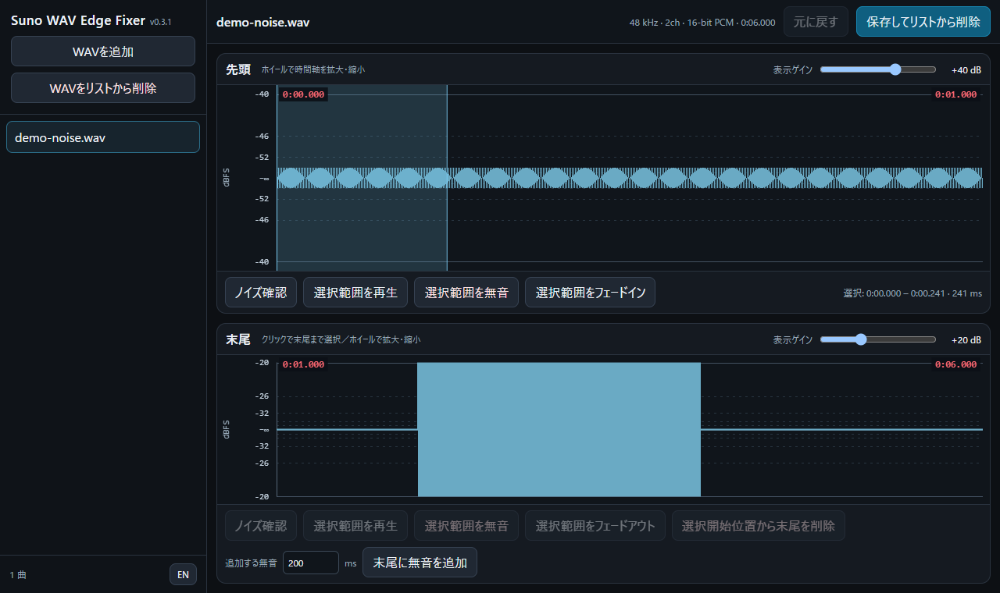

# Suno WAV Edge Fixer — User Manual

**Applies to v0.3.1 · Updated October 9, 2026**

## 1. Purpose

Suno WAV Edge Fixer is an offline, single-file browser application for manually cleaning up the **first and last few seconds of WAV files**. It is designed for album production: queue a set of tracks, inspect near-silent clicks using an amplified waveform display, apply small repairs, then download each result or simply remove unaffected tracks from the queue.

It does **not** automatically detect noise or work as a full audio editor. You choose every affected range.

## 2. Launch and import

1. Extract the distribution ZIP and open **`index.html`** in desktop **Chrome or Edge**, or open the GitHub Pages site if one is provided. Internet access, a backend, ffmpeg, and installation are unnecessary.
2. Drop one or more `.wav` files anywhere on the page, or click **Add WAVs**.
3. Click a filename in the left panel to load that track. Its filename, sample rate, channel count, sample format, and duration appear at the top.
4. Switch the UI language using **EN / 日本語** in the bottom-left corner.

Only the currently selected track is expanded for waveform editing. Editing operations are remembered per queued track until it is removed, but **the queue and unsaved edits are lost when you reload/close the page**. The originals remain unchanged.

## 3. Reading the waveforms

Two panels are always available:

| Parameter | Head | Tail |
| --- | --- | --- |
| Default time window | First **1 second** | Last **5 seconds** |
| Default display gain | **+40 dB** | **+20 dB** |
| Display gain | 0 to +60 dB | 0 to +60 dB |
| Mouse-wheel time window | 0.05 to 10 seconds | 0.5 to 20 seconds |

The Head display is anchored to time zero; the Tail display is anchored to the end of the current track. Use the **mouse wheel over either waveform** to zoom horizontally. Zooming clears the current selection.

The **Display gain** slider multiplies the waveform **for display only**. For example, +40 dB visually scales amplitude by 100. It does **not** alter the file or boost playback loudness. Visually clipped waveforms are not necessarily clipped in the source audio.

The left-hand scale is **dBFS of the underlying sample amplitude**, not LUFS or perceived loudness. With a +40 dB display gain, the top/bottom edges represent approximately −40 dBFS; half that distance from the center represents −46 dBFS; one quarter represents −52 dBFS. The center is zero amplitude (−∞ dBFS). Positive and negative excursions are mirrored; channels share the plot instead of appearing as separate tracks. These are axis marks, not automated peak measurements.

**Selecting time ranges:** Drag over the Head waveform to select a range. Drag over the Tail waveform, or **single-click the Tail waveform to select from that point through the end**. The highlighted selection and its start/end/duration appear below the graph. Editing boundaries are aligned to audio sample frames.

## 4. Head operations

**Silence selection:** Select a section (often before the first musical sound), then choose **Silence selection**. All samples within the chosen interval, across all channels, become digital silence. Samples outside it are untouched.

**Fade in selection:** Select the desired ramp, then choose **Fade in selection**. The linear amplitude ramp begins at zero at the selected start and rises toward the original amplitude at its end. The fade can start at any time in the Head window.

## 5. Tail operations

**Silence selection:** Remove unwanted sound or clicks after the music ends. You can click once to select through the end, or drag to isolate a shorter range.

**Fade out selection:** Choose the fade interval and press **Fade out selection**. The amplitude decreases linearly until the last selected sample, which is set to zero. To fade to the actual file end, single-click the Tail waveform at the intended fade start.

**Trim from selection start:** Choose the new ending location by clicking or dragging in the Tail waveform. Press **Trim from selection start** to **delete everything from the selected start to the original end**, regardless of where the selection ends. The duration and waveform update immediately. An abrupt trim may produce a click; consider a short fade before the new endpoint.

**Append silence:** Enter a number of milliseconds in **Silence to add** (default **200 ms**, valid **1–30,000 ms**) and press **Append silence**. The added samples are digital silence. The exact resulting duration is quantized to whole sample frames. For typical repairs, **trim → fade out → append a little silence if needed** is an understandable sequence.

## 6. Auditioning, undo and keyboard controls

Select a range and press **Play selection**. While playing, the button is green and reads **■ Playing (stop)**. Press it again to stop, or wait for the selection to finish. Playback uses **normal audio level**, not display gain. There is no full-track transport playback.

**Undo** reverts the last edit to the current track. It works for silence, fades, trim, and append; you may undo multiple edits in reverse order. **Redo is not available**. Removing a queued track is not undoable, although you can import the original file again.

**Check noise:** Select the sound to inspect and press **Check noise**, immediately to the left of **Play selection** in either panel. The app analyzes the entire selection and plays it once using a fixed gain shared between stereo channels. Click again, or press **Space / Escape**, to stop. Selection, zoom, and track changes also stop playback.

The automatic preview uses a fixed profile: **−18 dBFS maximum short-window RMS and a −12 dBFS sample-peak ceiling**. There is no preview level selector or separate preview row.

The loudest sliding 50 ms RMS window per channel and the full-selection peak both constrain gain, with at most +60 dB amplification. Shorter selections use their full length. Loud selections are attenuated. No compressor, EQ, or fade alters the noise's dynamics. If a large click prevents quieter sounds from being audible, narrow the selection. Silent selections do not play, and non-finite samples are rejected.

These limits apply to digital buffer samples; actual listening volume depends on your device settings. They are **not calibrated sound-pressure or true-peak limits** after browser resampling or hardware output. More than two channels are averaged to mono for noise preview only; opposite-phase channels may cancel. Preview processing never changes the source, edits, Undo history, or exported WAV. Display gain and ordinary playback remain independent.

Shortcuts refer to the **last waveform you clicked or dragged**:

| Shortcut | Action |
| --- | --- |
| `M` | Silence the current selection |
| `F` | Head: fade in / Tail: fade out |
| `Space` | Play/stop current selection |
| `Escape` | Stop normal or noise playback |
| `Ctrl + Z` (macOS: `⌘ + Z`) | Undo latest edit |
| `Enter` | Save and remove current track |

Playback stops with Space or Escape regardless of focus. Other shortcuts except Undo are inactive when a button or an input field has focus. `Ctrl/⌘ + Z` may still undo the app edit while an input field is focused.

## 7. Downloading versus removing

**Save & remove from list** requests a WAV download using the **same filename as the original**, then removes the track from the left-hand queue. This works even when no edits have been made. The destination is controlled by your browser—normally the Downloads folder; your browser may ask where to save or append `(1)` if the filename already exists. It does **not overwrite the source file**.

**Important:** The app removes the item when it *initiates* the download, not when it confirms that downloading has finished. If the browser blocks a download, check its download history and re-import the original as necessary.

**Remove WAV from list**, directly below **Add WAVs**, removes a track from the queue **without saving or downloading** anything. Use it for an unaffected track. This does not delete the original file from disk. Any queued, unsaved edits for that track are discarded.

## 8. File support and audio quality

The app edits compatible WAV **PCM samples directly** without re-encoding the untouched intervals, and retains the input sample rate, channel count and sample representation. Resizing updates the WAV data/header lengths (and relevant simple sample-count metadata where supported).

| Feature | Supported |
| --- | --- |
| Container | Standard little-endian RIFF/WAVE |
| Integer PCM | 8, 16, 24, 32-bit |
| IEEE float PCM | 32, 64-bit |
| Channels | 1–8 |
| Sample rates | 8,000–384,000 Hz |
| Not supported | MP3, compressed WAV, RF64, WAVE64, other audio formats |

Unusual WAVE chunk structures or location-dependent metadata may not be fully supported. Keep the originals and verify important exports by listening or checking the waveform in another audio program. Very long or high-channel/high-sample-rate WAV files may consume substantial browser memory.

## 9. Troubleshooting

- **A tiny click is visible but inaudible:** display gain is graphical only. Select the sound and press **Check noise**.
- **The waveform hits the plot edges:** reduce display gain. This is not evidence of source audio clipping.
- **A WAV does not load:** it may be a compressed, malformed or otherwise unsupported WAV. Try standard integer PCM WAV. Renaming MP3 to `.wav` does not convert it.
- **Cannot find an exported file:** inspect your browser's download list (usually `Ctrl + J`) and download settings.
- **Filename has `(1)` added:** this is your browser avoiding a same-name file collision.
- **Removed a file accidentally:** import the original file again; queued edits for it cannot be recovered.
- **Only want to trim the last second:** click at the desired new endpoint and use **Trim from selection start**—it is not a general-purpose delete-selected-range command.
- **Privacy:** imported WAV data are processed locally in the browser; the application contains no upload endpoint or external analytics code. Website hosting access logs are a separate matter.

## 10. License

MIT License, Copyright (c) 2026 cityedge — see [LICENSE](LICENSE). This is an unofficial tool, not affiliated with Suno.
